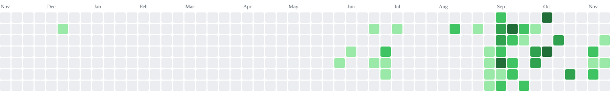

<div align="center">




<br/>

[](https://www.linkedin.com/in/ulises-pan)
[](mailto:panulises4@gmail.com)
[](https://ulises-pan.vercel.app)
[](https://ulises-pan.vercel.app/CV_Ulises_Pan.pdf)


</div>

<br/>

## 🕹️ SELECT PLAYER

<table>
<tr>
<td width="46%" valign="top">

```yaml
jugador:   Ulises Pan
clase:     Full Stack Dev · foco Frontend
nivel:     Jr  (egresado Henry, 2026)
base:      Pergamino, Buenos Aires 🇦🇷
modo:      remoto / híbrido
estado:    🟢 buscando primer equipo
poder:     entender la app de punta a punta
especial:  IA como copiloto, no como piloto
```

</td>
<td width="54%" valign="top">

**Hola, soy Ulises.** Construyo aplicaciones web con **React, Next.js y TypeScript** y las conecto con backends en **Node.js y PostgreSQL**.

Antes de programar pasé dos años en una línea de producción. De ahí traigo la constancia y el hábito de cumplir. En 2026 cambié de rumbo, me formé en Henry y desde entonces hago software todos los días.

Tengo **dos proyectos completos en producción** que puedo explicar línea por línea. Lo que entrego lo entiendo.

> 💬 *¿Tenés una búsqueda junior? Respondo en el día.*

</td>
</tr>
</table>

<br/>

## ⚔️ SKILL TREE

<table>
<tr>
<td valign="top" width="50%">

**🎨 FRONTEND**


`React` · `Next.js` · `TypeScript` · `JavaScript` · `HTML` · `CSS` · `Tailwind CSS`

**🗄️ DATOS**


`PostgreSQL` · `SQL` · `TypeORM` · `Supabase`

</td>
<td valign="top" width="50%">

**⚙️ BACKEND**


`Node.js` · `Express` · `NestJS` · `APIs REST` · `JWT`

**🧰 INVENTARIO**


`Git` · `GitHub` · `Vercel` · `Render` · `Netlify` · `Postman` · `Vite`

</td>
</tr>
</table>

<div align="center">

<a href="https://skillicons.dev"></a>

</div>

<br/>

## 🗺️ MISIONES COMPLETADAS

<table>
<tr>
<td width="50%" valign="top">

### 🏆 LEVEL 2 · Campus
`modo co-op · equipo de 6 · sep–oct 2026`

Plataforma de cursos online con un **tutor de IA** que acompaña cada lección. Roles de alumno, docente y admin, catálogo, reproductor con progreso y pagos.

**Mi parte (frontend):**
- 🔐 Registro, login y acceso con Google
- 🧭 Dashboards por rol con rutas protegidas
- 🎬 Catálogo, reproductor y progreso de lecciones
- 💳 Checkout con Stripe + integración con la API REST
- 🤖 Prompt del tutor acotado a la lección abierta

**Boss derrotado:** un chat de IA que se iba por las ramas. Le inyecté el contenido de la lección al system prompt y dejó de contestar cualquier cosa.


  

[](https://campus-ai-bice-eight.vercel.app)
[](https://github.com/CampusPF/pf-front)
[](https://github.com/CampusPF/pf-back)

</td>
<td width="50%" valign="top">

### 🥇 LEVEL 1 · Barber Turnos
`modo solo · may–jul 2026`

Sistema de turnos online: los clientes reservan y el dueño administra servicios y agenda. Lo empecé en Henry y lo terminé y desplegué por mi cuenta.

**Lo que construí (full stack):**
- 🧱 API REST en capas con Express + TypeScript
- 🔑 Auth con JWT y bcrypt, middleware de admin
- 🗄️ PostgreSQL + TypeORM: usuarios, turnos, servicios
- 📧 Emails automáticos al reservar y cancelar
- 🛡️ Zod, Helmet y rate limit en el login

**Boss derrotado:** dos clientes reservando el mismo horario. El backend valida cada turno contra la agenda del día y solo ofrece horarios libres.


  

[](https://chaco-barber.netlify.app)
[](https://github.com/UlisesPan/barber-turnos)

<sub>⏳ El servidor gratuito se duerme: la primera carga puede tardar un minuto.</sub>

</td>
</tr>
</table>

<br/>

## 👾 ARCADE · mis commits son el mapa

<div align="center">

Cada cuadradito es un día de código. Pac-Man se los come.

<picture>
  <source media="(prefers-color-scheme: dark)" srcset="https://raw.githubusercontent.com/UlisesPan/UlisesPan/output/pacman-contribution-graph-dark.svg">
  <source media="(prefers-color-scheme: light)" srcset="https://raw.githubusercontent.com/UlisesPan/UlisesPan/output/pacman-contribution-graph.svg">
  
</picture>

</div>

<details>
<summary><b>🐍 BONUS STAGE · Snake</b></summary>
<br/>
<picture>
  <source media="(prefers-color-scheme: dark)" srcset="https://raw.githubusercontent.com/UlisesPan/UlisesPan/output/snake-contribution-graph-dark.svg">
  <source media="(prefers-color-scheme: light)" srcset="https://raw.githubusercontent.com/UlisesPan/UlisesPan/output/snake-contribution-graph.svg">
  
</picture>
</details>

<details>
<summary><b>🟪 BONUS STAGE · Tetris</b></summary>
<br/>
<picture>
  <source media="(prefers-color-scheme: dark)" srcset="https://raw.githubusercontent.com/UlisesPan/UlisesPan/output/tetris-contribution-graph-dark.svg">
  <source media="(prefers-color-scheme: light)" srcset="https://raw.githubusercontent.com/UlisesPan/UlisesPan/output/tetris-contribution-graph.svg">
  
</picture>
</details>

<br/>

<div align="center">

### 🔥 COMBO ACTUAL


</div>

<br/>

## 📼 SAVE FILES

```
 ┌──────────────────────────────────────────────────────────────────┐
 │  SLOT 1  ▸ 2023–2025   Frigorífico ArreBeef                      │
 │             Dos años en producción por turnos. Constancia +100   │
 ├──────────────────────────────────────────────────────────────────┤
 │  SLOT 2  ▸ Ene 2026    Empiezo en Henry                          │
 │             JS · TS · React · Next · Node · Nest · PostgreSQL    │
 ├──────────────────────────────────────────────────────────────────┤
 │  SLOT 3  ▸ May 2026    Barber Turnos                             │
 │             Primer full stack propio, de la DB al deploy         │
 ├──────────────────────────────────────────────────────────────────┤
 │  SLOT 4  ▸ Sep 2026    Campus (co-op ×6)                         │
 │             Ramas, pull requests y entregas con fecha            │
 ├──────────────────────────────────────────────────────────────────┤
 │  SLOT 5  ▸ Oct 2026    Egreso                                    │
 │             ★ NEW GAME+ desbloqueado: primer trabajo dev         │
 └──────────────────────────────────────────────────────────────────┘
```

<br/>

## 🪙 INSERT COIN

<div align="center">

Puedo hacer una prueba técnica o mostrarte el código de cualquier proyecto en una llamada.

[](mailto:panulises4@gmail.com?subject=Contacto%20desde%20GitHub)
[](https://www.linkedin.com/in/ulises-pan)
[](https://ulises-pan.vercel.app)

<br/>



<sub>Hecho con 🕹️ y pixel art dibujado a mano en SVG · Ulises Pan, 2026</sub>

</div>
